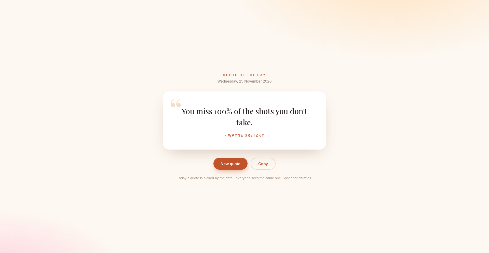

# Quote of the Day

A tiny vanilla JS app that serves one quote every day. The daily quote is seeded by the date, so it stays the same all day for everyone; hit **New quote** (or the spacebar) to shuffle through the rest, and **Copy** to grab one for a status or a message.

One of my earliest JavaScript projects, upgraded from its original seven-quote version: quotes now carry authors, the design got a proper look, and the copy button and daily seed are new.

**Live demo:** https://malakmo7amed309.github.io/quote-of-the-day/

## Stack

- HTML5
- CSS3 (custom, no framework)
- Vanilla JavaScript

## Standout detail

The quote of the day is deterministic: a date-seeded index picks it, so there is no random jump on every reload - it changes once a day, like a real quote-a-day calendar.

## Run it locally

It is a static site - open `index.html`, or serve the folder:

```bash
python3 -m http.server
```

GitHub Pages serves the copy in `docs/`.

## Screenshot


